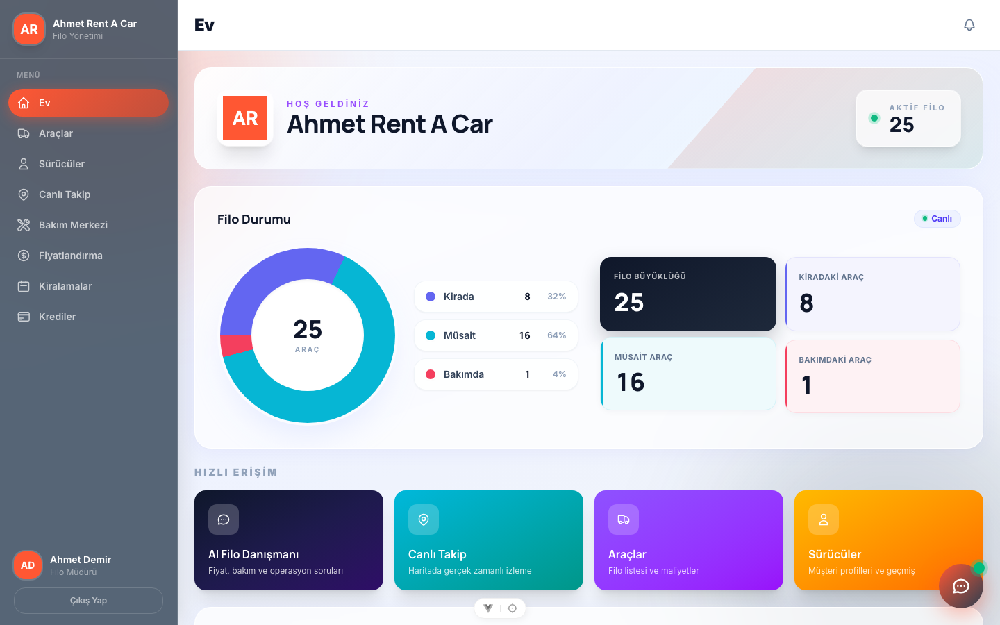
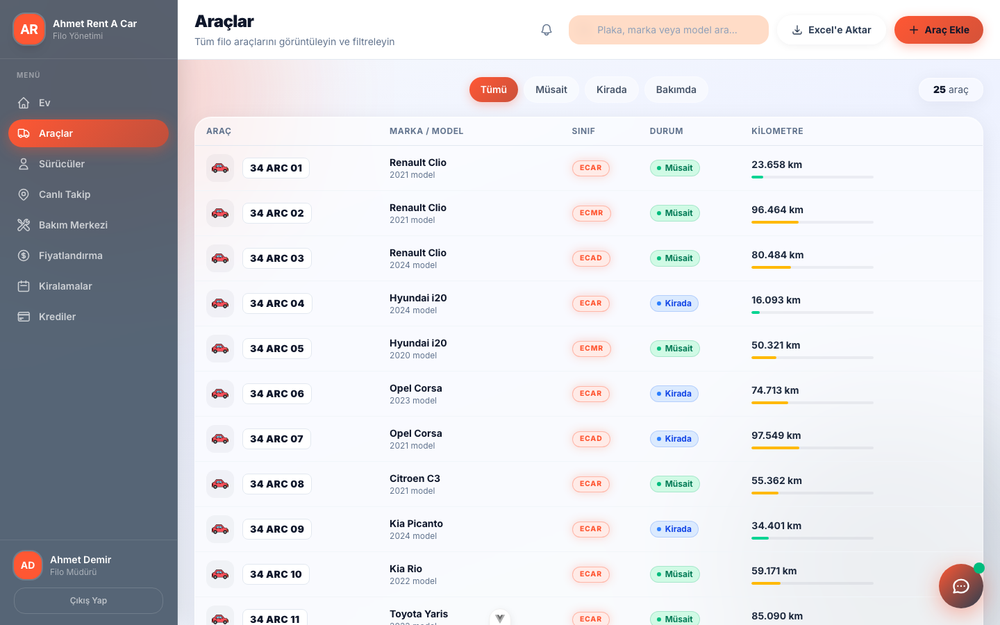
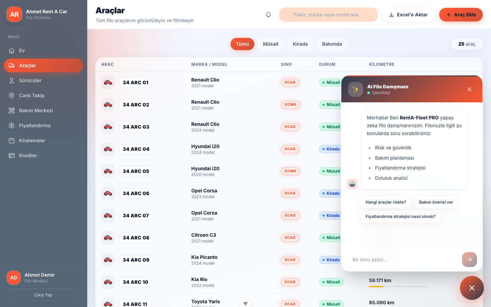
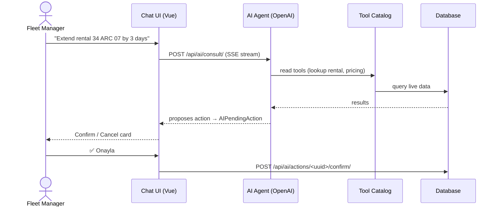
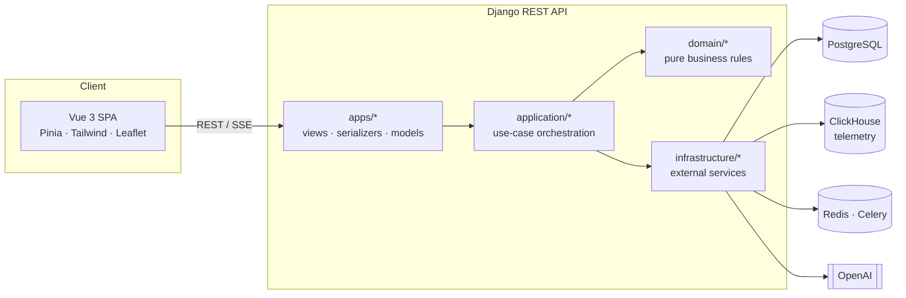

<div align="center">

# 🚗 RentA-Fleet PRO

### The all-in-one operating system for rent-a-car fleets

**Fleet inventory · Driver risk scoring · Rental lifecycle · Cost & pricing intelligence · Live GPS · AI operations agent**

<br/>


[](https://github.com/Batuhan-METU/rentafleet-pro/actions/workflows/ci.yml)

<br/>



</div>

---

## 📌 What is RentA-Fleet PRO?

Running a rent-a-car company means juggling dozens of moving parts: which car is where, which driver is risky, what a vehicle *really* costs per day, and what price still makes a profit. Most small and mid-size fleets manage this with spreadsheets.

**RentA-Fleet PRO** replaces those spreadsheets with a single **multi-tenant SaaS platform**. Each rental company gets its own branded workspace, and every decision, from renting a car to pricing it, is backed by live data.

> 🇹🇷 Built for the Turkish rent-a-car market. The UI and domain language are Turkish, while the codebase and docs are developer-friendly.

---

## ✨ Feature Highlights

<table>
<tr>
<td width="50%" valign="top">

### 🚙 Fleet Management
- Full vehicle inventory with status tracking (available, rented, in maintenance)
- SIPP / ACRISS vehicle classification
- Vehicle documents, mileage tracking and one-click **Excel export**
- **Predictive maintenance** center that flags vehicles before they break

</td>
<td width="50%" valign="top">

### 🛡️ Driver Risk Scoring
- Automated **risk score (0–100)** on driver onboarding
- Pure, testable **rule engine** with configurable thresholds
- Eligibility checks and deposit rules derived from risk level
- Full audit trail of every risk decision

</td>
</tr>
<tr>
<td width="50%" valign="top">

### 📋 Rental Lifecycle
- Create, extend, cancel and return rentals
- **Early return** and **extension** workflows with automatic recalculation
- Step-by-step rental workflow progress UI
- Idempotent API endpoints, so double clicks never double-book

</td>
<td width="50%" valign="top">

### 💰 Cost & Pricing Intelligence
- True **daily cost per vehicle**: loan interest, insurance, overhead, opex and cash opportunity cost
- **Floor price** engine that tells you the lowest profitable price
- **Market price comparison** that matches your cars with comparable listings
- Loan (kredi) tracking and allocation per vehicle

</td>
</tr>
<tr>
<td width="50%" valign="top">

### 📍 Live GPS Tracking
- Real-time vehicle map built with **Leaflet**
- Telemetry stored in **ClickHouse** for fast time-series queries
- Fleet-wide analytics and occupancy insights

</td>
<td width="50%" valign="top">

### 🤖 AI Fleet Operations Agent
- A real **function-calling agent**, not just a chatbot
- Queries live fleet, driver, rental and financial data
- Proposes real actions (create rental, return vehicle, onboard driver…)
- Every write needs **human confirmation** before it runs

</td>
</tr>
</table>

---

## 📸 Screenshots

<div align="center">

| 🚙 Vehicle Inventory | 🤖 AI Fleet Consultant |
|:---:|:---:|
|  |  |

</div>

---

## 🤖 Inside the AI Operations Agent

The chat assistant is a tool-using agent that works on the same data and rules as the rest of the app.



- 🔒 **Safe by design.** Mutations are stored as a pending action with a 5-minute TTL. They are single-use and scoped to the user's company.
- 🧩 **One source of truth.** Every tool's JSON schema is generated from the same DRF serializer the HTTP endpoint uses, so the agent can never drift from the real API.
- 🛟 **Graceful fallback.** Without an `OPENAI_API_KEY`, the assistant falls back to deterministic, data-grounded answers instead of failing.
- 🧾 **Auditable.** AI-driven changes are tagged in the audit log, so they are always distinguishable from manual actions.

---

## 🏗️ Architecture

The backend follows a layered **clean architecture**. Business rules live in a pure domain layer with zero framework imports, which keeps them fast to test and easy to reason about.



| Layer | Responsibility |
|---|---|
| `backend/apps/` | Django apps: HTTP views, serializers, models, URLs |
| `backend/application/` | Use-case orchestration across ORM, domain and infrastructure |
| `backend/domain/` | Pure business rules: risk scoring, eligibility, deposits, rule engine |
| `backend/infrastructure/` | Cost calculation, market pricing, ClickHouse, reporting, AI tools |
| `backend/common/` | Middleware, permissions, multi-tenancy, audit helpers |
| `frontend/src/` | Vue 3 Composition API (`<script setup>`) + Pinia SPA |

**Multi-tenancy.** Companies are resolved by subdomain (`<company>.rentafleetpro.com`) or a `?company=<slug>` parameter. Row-level data scoping always keys off the authenticated user's company.

---

## 🚀 Getting Started

### Prerequisites

- Python **3.13**
- Node.js **22.18+**
- PostgreSQL *(optional in dev, SQLite is used when `DJANGO_DEBUG=true`)*
- ClickHouse and Redis *(optional, the app degrades gracefully without them)*

### 1️⃣ Backend

```sh
cd backend
python -m venv .venv && source .venv/bin/activate
pip install -r requirements-dev.txt
cp .env.example .env
python manage.py migrate
python manage.py fleet_ops seed      # creates two branded demo companies
python manage.py runserver
```

### 2️⃣ Frontend

```sh
cd frontend
npm install
npm run dev
```

The dev server proxies `/api` to `http://127.0.0.1:8000`. Open the URL Vite prints and log in.

### 🔑 Demo accounts

| Company | Username | Password |
|---|---|---|
| Ahmet Rent A Car | `ahmet_mudur` | `ahmet123` |
| Ercan Rent A Car | `ercan_mudur` | `ercan123` |

<details>
<summary><b>⚙️ Optional: Redis cache and Celery background jobs</b></summary>

<br/>

Set `REDIS_URL` (for example `redis://127.0.0.1:6379/0`) to enable a shared cache and asynchronous Celery tasks. Without it, the cache falls back to in-process memory and tasks run synchronously.

```sh
redis-server --daemonize yes
celery -A backend.celery_app worker --loglevel=info
celery -A backend.celery_app beat --loglevel=info
```

For bulk randomized data with telemetry, run `python manage.py seed_data`.

</details>

---

## ☁️ Deployment

One **Render** web service runs everything. Django serves the API at `/api/*` and the built Vue SPA at `/` through WhiteNoise, so there is one URL and no CORS setup.

<details>
<summary><b>📦 Deploy to Render (free tier)</b></summary>

<br/>

1. On [render.com](https://render.com) choose **New + → Blueprint** and connect this repo. Render reads [`render.yaml`](render.yaml) and provisions the web service plus a free PostgreSQL database.
2. In the service's **Environment** tab, set `OPENAI_API_KEY`. Everything else is already wired up.
3. Wait for the build, then open the `*.onrender.com` URL.
4. Seed demo data once from the service's **Shell** tab:
   ```sh
   python backend/manage.py fleet_ops seed --i-know-this-is-not-prod
   ```

**Free-tier notes**

- The service sleeps after 15 minutes idle, so the first request can take 30–60 seconds.
- Free PostgreSQL expires after 30 days. Point `DATABASE_URL` at any Postgres provider to move it.
- Wildcard subdomains are not available, so tenants are selected with `?company=<slug>`.
- Uploaded files are not persisted across deploys on the free tier.

</details>

<details>
<summary><b>🐳 Docker</b></summary>

<br/>

A multi-stage [`Dockerfile`](Dockerfile) builds the frontend with Node and serves everything with gunicorn.

```sh
docker build -t rentafleet-pro .
docker run -p 8000:8000 -e DJANGO_DEBUG=true rentafleet-pro
```

</details>

---

## 🧪 Quality & Testing

Every push and pull request runs the full pipeline in **GitHub Actions**. Lint and type errors are hard gates.

| Area | Tooling |
|---|---|
| Backend tests | `pytest` + `pytest-django` |
| Backend lint | `ruff` (zero findings) |
| Backend types | `mypy` + `django-stubs` (zero findings) |
| Frontend tests | `vitest` + Vue Test Utils |
| Frontend lint | `eslint` + `prettier` |
| Build | Production Vite build |

```sh
# Backend
python -m pytest backend/tests -q
ruff check backend
mypy backend --config-file pyproject.toml

# Frontend
cd frontend && npm run test && npm run lint && npm run build
```

---

## 📂 Project Structure

```
rentafleet-pro/
├── backend/
│   ├── apps/              # Django apps (vehicles, rentals, risk_checks, ai, …)
│   ├── application/       # Use cases (customer, driver, rental, risk)
│   ├── domain/            # Pure rules (risk, eligibility, deposit, rule_engine)
│   ├── infrastructure/    # Cost calculation, market pricing, AI tools, reporting
│   ├── common/            # Middleware, permissions, multi-tenancy, audit
│   └── tests/
├── frontend/
│   └── src/               # Vue 3 views, components, Pinia stores, composables
├── docs/screenshots/
├── Dockerfile
└── render.yaml
```

---

## 📚 Further Reading

- 📘 [Vehicle cost & profitability methodology](MALIYET_HESAPLAMA_METODOLOJISI.md)
- 📗 [Detailed daily cost calculation](GUNLUK_MALIYET_HESAPLAMA_DETAYLI.md)

---

<div align="center">

### 👨‍💻 Author

**Batuhan Başoda**
Computer Engineering @ METU

[](https://github.com/Batuhan-METU)

<br/>

⭐ **If you find this project interesting, consider giving it a star!** ⭐

</div>
